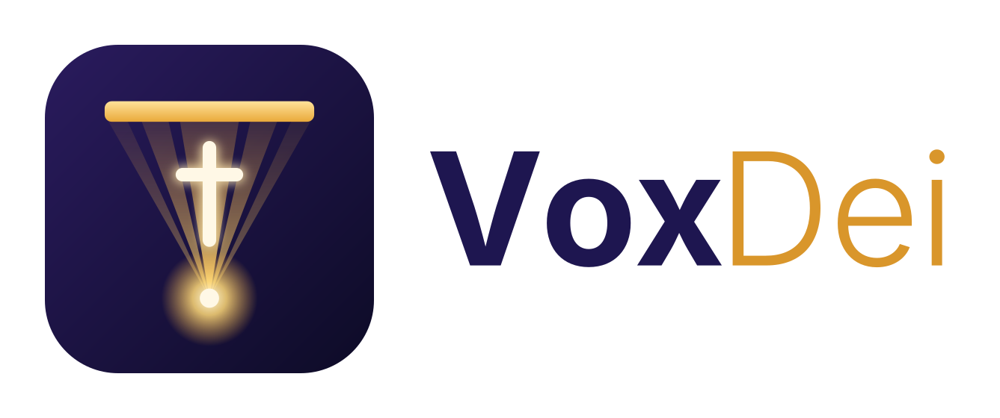

<h1 align="center">
  <picture>
    <source media="(prefers-color-scheme: dark)" srcset="src/assets/voxdei-logo-horizontal-fondo-oscuro.svg">
    
  </picture>
</h1>

<strong>La pantalla de tu iglesia, controlada desde tu celular.</strong>

VOXDEI proyecta en la pantalla grande del templo lo que necesites durante el servicio: versículos, anuncios, el título de la prédica o mensajes que se desplazan por abajo. Todo se maneja desde un celular, una tablet o un computador, y lo que escribes aparece al instante en la proyección.

---

## Cómo funciona

VOXDEI trabaja con **dos pantallas al mismo tiempo**:

| | |
|---|---|
| **La pantalla de proyección** | Es la que ve la congregación. Se abre en el computador conectado al proyector o al televisor. Solo muestra contenido: no tiene botones ni menús. |
| **El panel de control** | Es el que usas tú. Desde el celular o el computador eliges qué se muestra y cuándo. |

Todo lo que haces en el panel aparece en la proyección de inmediato, sin recargar nada. Puedes estar en la primera fila con el celular mientras la pantalla del templo obedece.

---

## Tu iglesia es solo tuya

Cuando registras tu iglesia en VOXDEI, se crea un espacio privado para ella.

- Tus versículos, anuncios y prédicas **solo los ve tu iglesia**.
- Solo tú y las personas a las que tú les des acceso pueden escribir en tu pantalla.
- Si otro pastor usa VOXDEI, registra su propia iglesia y su contenido **nunca se mezcla con el tuyo**.

Nadie desde fuera puede cambiar lo que se proyecta en tu templo.

---

## Primeros pasos

### 1. Registra tu iglesia

En la pantalla de inicio, entra a **Registrar iglesia** y completa el nombre de la iglesia, tu nombre, tu correo, tu género, una contraseña y, si quieres, una foto de perfil (sin foto se ven tus iniciales).

La contraseña debe tener al menos 12 caracteres, con una mayúscula, una minúscula, un número y un símbolo; debajo del campo verás cuáles te faltan. Después te llegará un correo con un enlace: ábrelo para activar tu iglesia.

Quien registra la iglesia queda como **pastor o pastora**: es el dueño de la cuenta y quien manda.

### 2. Entra al panel

Al iniciar sesión verás dos botones grandes:

- **Proyectar** — en el dispositivo conectado al proyector (computador, tablet o celular), abre la ventana que se ve en el templo. Arrástrala a la pantalla del proyector y toca el botón del centro para ponerla en pantalla completa. Si la pantalla ya está abierta en algún equipo, esta opción no aparece.
- **Administrar** — abre el panel con todas las herramientas, en ese mismo dispositivo o en otro.

Dentro del panel cambias de sección con un toque: en el computador, con la **barra de la izquierda**; en el celular, con la **barra de abajo** (Biblia, Canciones, Culto, Mensajes y **Más** para el resto). Si es tu primera vez, abre **Ayuda**: explica paso a paso cómo preparar la pantalla para el servicio.

### 3. Suma a tu equipo

Desde **Administrar → Usuarios** puedes crear cuentas para las personas que te ayudan.

Si registraste la iglesia, lo primero que verás es la opción de dar de alta a tu pareja: si la registró un pastor, aparece **Pastora**, y si la registró una pastora, aparece **Pastor**. Una vez están los dos, esa opción desaparece y todas las cuentas que crees después serán **Operador**.

La primera vez que cada persona entre, la app le pedirá confirmar su correo con el botón **Enviarme el enlace**. Si no le llega, revisa que escribiste bien su dirección; si estaba mal, elimina la cuenta y créala de nuevo.

---

## Quién puede hacer qué

| Rol | Quién es | Qué puede hacer |
|---|---|---|
| **Pastor / Pastora** | Quien registró la iglesia y su pareja | Todo |
| **Operador** | Quien maneja la pantalla durante el servicio | Proyectar versículos, anuncios, mensajes, canciones, imágenes y video **en su turno** (mira *Cronograma*) |

Un operador puede manejar la pantalla sin riesgo de que modifique las prédicas guardadas ni las cuentas del equipo: la sección de prédicas ni le aparece, y en **Usuarios** solo puede ver al equipo y eliminar su propia cuenta.

Sobre eliminar cuentas:

- A la cuenta que **registró la iglesia no la puede borrar nadie más**. Solo ella misma, y al hacerlo se borra la iglesia completa: sin su dueño, la iglesia no puede seguir.
- A la **pareja pastoral** solo la puede eliminar quien registró la iglesia.
- A un **operador** lo puede eliminar cualquiera de los dos pastores.
- **Cada persona puede eliminar su propia cuenta** desde su ficha en **Usuarios**.

Cada persona puede cambiar **su propia foto**, y solo la suya: en **Usuarios**, toca el lápiz junto a tu nombre y, en tu ficha, toca la foto (la del icono de cámara). Nadie puede cambiarse su propio rol.

---

## Las herramientas

### Ticker (la cinta de abajo)

Es el texto que se desliza por la parte inferior de la pantalla, como en los noticieros. Sirve para anuncios que deben verse todo el tiempo sin estorbar.

- Escribe el anuncio y toca **Proyectar** para mandarlo de una vez.
- O toca **Guardar** para dejarlo listo y usarlo cuando quieras: aparece como una tarjeta y basta con tocarla.
- Puedes guardar hasta **6 anuncios**. Al guardar el séptimo, se reemplaza el más antiguo.
- La barra de **velocidad** regula qué tan rápido se desplaza el texto.

### Mensajes

Textos que se muestran en grande en el centro de la pantalla. Funciona igual que el ticker: escribes, proyectas o guardas, y puedes tener hasta **6 mensajes** listos para usar.

### Prédica

Te permite armar la prédica completa **antes** del servicio y luego ir pasándola punto por punto.

1. Escribe un título y un mensaje, y tócalos para agregarlos a la lista.
2. Agrega los versículos que vas a citar, buscándolos por libro, capítulo y versículo.
3. Guarda la prédica terminada en uno de los **5 espacios** disponibles.

Durante el servicio abres la prédica guardada y vas tocando cada punto para proyectarlo en orden. También puedes **enviar la prédica por WhatsApp** con el botón verde.

### Biblia

La Biblia completa, para buscar y proyectar en el momento.

- Busca el libro escribiendo su nombre (no importan las tildes: "genesis" encuentra "Génesis").
- Elige capítulo y versículo.
- Puedes proyectar un versículo suelto o el capítulo completo para leerlo en pantalla.

### Imágenes

Sube fotos sueltas o una carpeta entera y proyéctalas en la pantalla.

- Toca cualquier miniatura guardada para mandarla a la pantalla al instante.
- Para pasar varias seguidas, márcalas con el círculo de la esquina y usa **Proyectar juntas**: irán cambiando solas según los segundos que indiques en *Tiempo por imagen*.
- El botón con el ícono de foto enciende y apaga la imagen sin borrar nada. En verde, la imagen está en pantalla.

La imagen ocupa el centro de la pantalla. Si tienes encendido el título, se sigue viendo arriba, y el ticker sigue corriendo abajo.

### Video

Para proyectar videos de YouTube durante el servicio.

- Copia el enlace del video en YouTube y pégalo. Ponle un nombre para reconocerlo después.
- Toca **Guardar** y queda en la lista, listo para volver a usarlo cualquier domingo.
- Toca el video de la lista para mandarlo a la pantalla.

Dos cosas que conviene saber antes de usarlo en un servicio:

- **El video se descarga directo de YouTube al computador de proyección.** Si el internet del templo va justo, se puede entrecortar. Vale la pena probarlo antes.
- **Para que se escuche hay que poner la pantalla en completa.** El navegador no deja que un video empiece con sonido por su cuenta; ese es el gesto que lo desbloquea.

### Canciones

Para proyectar las letras durante la alabanza.

**El catálogo es común a todas las iglesias.** Las canciones que carga cualquier iglesia quedan disponibles para las demás, así el repertorio crece entre todos. Eso sí: cada iglesia solo puede editar o borrar las canciones que ella misma subió.

**La lista de hoy es solo tuya.** Buscas las canciones del servicio, las agregas con el botón **+**, y quedan ordenadas arriba en *Canciones de hoy*. Esa lista es privada de tu iglesia y la puedes vaciar cuando termines.

Para cargar una canción nueva toca **+ Canciones**, arriba: se abre una pantalla donde escribes el título y **pegas la letra completa**. Deja un renglón en blanco entre estrofa y estrofa, y la aplicación crea una lámina por cada bloque. Te va contando cuántas láminas quedarán mientras pegas. La misma pantalla se abre con el lápiz para corregir una canción tuya.

Durante el servicio, abres la canción y **tocas cada lámina** para proyectarla. Si operas desde el computador, también funcionan las flechas del teclado. La lámina que está en pantalla queda marcada en verde, para no perderte a mitad de canción, y arriba, al lado del nombre de la canción, ves en cuál vas y cuántas hay.

**En pantalla sale solo la letra.** El nombre de la canción no se proyecta, porque a quien está cantando no le aporta nada. Por eso esta sección no tiene interruptor de título: solo el del **ticker** y el del **texto**. El ticker se enciende solo al entrar, para que los anuncios sigan pasando durante la alabanza; si estorba, se apaga con su interruptor.

### Estilos y colores

Aquí decides cómo se ve la pantalla del templo. A la izquierda tienes una **vista previa en vivo**: puedes ver cómo queda un mensaje, un versículo o una letra de canción, y cómo se ve en el proyector o en un celular.

Puedes ajustar:

- **Fondo** — color plano o degradado.
- **Título** — color, tamaño, alineación, negrita y mayúsculas.
- **Texto principal** — color, tamaño, separación entre renglones y alineación. Aplica a mensajes, prédica y canciones.
- **Versículos** — color del encabezado y de la cita, tamaño de la cita, y ocultarla si prefieres.
- **Ticker** — color de fondo y de texto propios, tamaño y alto de la cinta.
- **Legibilidad** — sombra del texto y margen de seguridad (ver abajo).
- **Transiciones** — que el contenido aparezca con un fundido suave en vez de un corte seco.

Si tienes prisa, usa los **temas rápidos**: Clásico, Alto contraste, Claro y Cálido dejan todo listo de un toque.

Los cambios se ven en la vista previa mientras los haces, pero **solo llegan a la pantalla del templo cuando tocas Guardar**. Así puedes probar con calma durante el servicio sin que la congregación vea los intentos.

**Dos ajustes que valen oro:**

- **Sombra del texto**: es lo que permite leer sobre fondos claros. Si el texto se pierde, súbela.
- **Margen de seguridad**: casi todos los proyectores recortan los bordes de la imagen. Si se te cortan las letras de las orillas, súbelo.

### Cronograma

Aquí el pastor o la pastora deciden **quién maneja la pantalla en cada servicio**, para que dos personas no se pisen enviando cosas a la vez.

Cada servicio se arma como una alarma del celular: hora de inicio y de fin, los días en que se repite (`L M X J V S D`) y el operador asignado. Por ejemplo: domingo de 8:00 a 10:00, Carlos; de 10:00 a 12:00, Pedro. Si no marcas ningún día, el servicio es de una sola vez y eliges la fecha. Con el interruptor **Activo** puedes pausar un servicio sin borrarlo.

Quién puede proyectar en cada momento:

- **Durante un servicio**: el operador asignado. Si dos servicios se cruzan, manda el que empezó más tarde.
- **El pastor y la pastora**: siempre, en cualquier momento.
- **Fuera de los servicios**: quien tenga el **ensayo**. Un operador lo inicia con el botón **Iniciar ensayo** (y desde el Cronograma se le puede dar a otro). El ensayo termina cuando lo cierran, cuando empieza un servicio o a las 3 horas. Si quien lo tenía ya se fue, otro operador puede **tomarlo**.

Arriba de cada sección de proyección, una franja dice de quién es el turno: **verde** si puedes proyectar y **roja** si no. Fuera de tu turno puedes seguir preparando cosas (escribir mensajes, guardar favoritos, armar la lista de canciones, subir imágenes); lo único que no puedes es enviarlas a la pantalla. **Estilos y colores** queda libre.

Los operadores ven el cronograma, pero no lo pueden cambiar.

### Usuarios

Entra todo el equipo, pero solo el pastor y la pastora crean y eliminan cuentas. Un operador ve la lista del equipo y nada más; en su propia ficha tiene el botón **Eliminar mi cuenta**.

Crea las cuentas de tu equipo con nombre, correo y contraseña. El rol solo se pregunta mientras falte tu pareja pastoral; después, todas las cuentas nuevas son de **Operador**.

En la pestaña del equipo ves a todos los tuyos. Al tocar el lápiz junto a un nombre se abre su ficha, y desde ahí puedes eliminar la cuenta si tienes permiso para hacerlo (mira la tabla de *Quién puede hacer qué*). Al eliminar se borra todo: su acceso, su ficha y su foto. En tu propia ficha el botón dice **Eliminar mi cuenta** y te pide la contraseña para confirmar.

El rol de una persona no se puede cambiar después: se elige al crear la cuenta.

---

## Controlar qué se ve en pantalla

Durante el servicio no siempre quieres mostrarlo todo. En cada herramienta hay tres interruptores que encienden y apagan partes de la pantalla por separado:

| Ícono | Controla |
|---|---|
| 🔖 **Marcador** | El título de arriba |
| 💬 **Globo de diálogo** | El texto grande del centro (mensaje, versículo o letra) |
| 🏷️ **Etiqueta** | La cinta que se desliza abajo |
| 🖼️ **Foto** | La imagen del centro (en la sección de Imágenes) |
| 🎬 **Cámara de video** | El video del centro (en la sección de Video) |
| 📺 **Televisor** | Deja encendido **solo** lo de esa sección y apaga el resto |

Se encienden en verde cuando están activos. Así puedes, por ejemplo, dejar solo el ticker mientras la congregación canta, y encender el texto grande justo cuando llega el versículo.

En el celular estos controles están agrupados dentro de un botón de menú.

---

## Preguntas frecuentes

**¿Necesito instalar algo?**
No. VOXDEI funciona en el navegador, tanto en el celular como en el computador.

**¿Puedo controlar la pantalla desde el celular mientras predico?**
Sí. Es justamente para lo que está pensada.

**¿Qué pasa si se me cierra la ventana de proyección?**
Vuelve a entrar y toca **Proyectar**. Lo que estaba proyectado sigue ahí.

**¿Otra iglesia puede ver mis prédicas?**
No. Cada iglesia tiene su espacio separado.

**Olvidé mi contraseña.**
En la pantalla de inicio de sesión hay un enlace para recibir un correo de recuperación.

**¿Cuántos anuncios y prédicas puedo guardar?**
Hasta 6 anuncios de ticker, 6 mensajes y 5 prédicas completas. Al pasarte, se reemplaza el más antiguo. Las canciones y las imágenes no tienen límite.

**Si otra iglesia borra una canción del catálogo, ¿pierdo la mía?**
No. Cada iglesia solo puede editar o borrar las canciones que ella misma subió.

**¿Cómo elimino mi cuenta?**
Entra a **Usuarios**, toca el lápiz junto a tu nombre y pulsa **Eliminar mi cuenta**; escribe tu contraseña y confirma. También puedes hacerlo desde la página `/EliminarCuenta` sin abrir la app. Se borran tu cuenta, tu nombre, tu correo y tu foto. Si eres quien registró la iglesia, se borra **la iglesia completa**: todos sus usuarios, prédicas, mensajes, tickers, imágenes y estilos. Las canciones que aportó al catálogo común se quedan, sin el nombre de la iglesia. No se puede deshacer.

---

## Novedades

Aquí queda anotado lo que va cambiando en la aplicación, para que siempre sepas qué es nuevo.

### 12 de noviembre de 2026

- **«Predicar», arriba de Mis prédicas.** En el computador, el botón **▶ Predicar** está ahora arriba de la lista *Mis prédicas*, donde antes estaba «Nueva», y ya no va encima del título. Para empezar una prédica nueva no hace falta botón: al entrar a *Prédica* el bosquejo ya está listo para escribir, y se guarda solo en cuanto escribes algo.
- **El calendario ya no crea prédicas por error.** Antes, tocar un día libre creaba un borrador al instante, aunque solo quisieras ver la fecha. Ahora, en el computador, tocar un día libre pone esa fecha en el bosquejo vacío (el día queda marcado con un círculo dorado), y la prédica solo se crea cuando escribes algo. En el celular, tocar un día solo lo marca: debajo aparece «Crear para este día» si está libre, o la prédica de ese día con «Preparar» y «Predicar». Los días grises del mes vecino te llevan a ese mes, y el botón **Hoy** te regresa al mes actual.
- **El calendario, más fácil de leer.** Los días con prédica ya no llevan un puntito debajo: ahora tienen un **círculo punteado** del color de su estado (naranja borrador, azul terminada, verde predicada, rojo sin predicar). El día que elegiste lleva un círculo dorado continuo, y **hoy** se ve en **violeta**.
- **Los borradores ahora son naranjas.** Antes eran dorados, pero el dorado es el color propio de la aplicación y se confundía con todo lo demás. Ahora se ven en naranja en la lista, el filtro, el botón de estado y el calendario. En la lista de *Mis prédicas*, los nombres de los meses pasan a dorado.
- **Una prédica terminada siempre tiene fecha.** Si una prédica no tiene fecha (por ejemplo, una copia hecha con «Duplicar») y la quieres marcar como **Terminada**, la aplicación te pide primero la fecha y abre el calendario para elegirla. Al elegir el día, queda terminada sola, sin volver a tocar el botón. Para volver a borrador no hace falta fecha.
- **Más orden arriba del bosquejo y en la lista.** El botón de estado (Borrador / Terminada) pasa al extremo derecho del recuadro de arriba, y junto a la serie se ve ahora el **versículo base** de la prédica (el primero que agregaste), en el color de los versículos y sin ícono. En *Mis prédicas*, el versículo también baja junto a la serie: la línea de arriba queda solo con la fecha y la cantidad de ítems, y se lee mejor.
- **Deshacer y Rehacer en Prédica.** Si cambias algo y te arrepientes, la flecha **↶ Deshacer** lo devuelve a como estaba, paso a paso, y **↷ Rehacer** lo vuelve a poner. Sirven para el título, la serie, la fecha, el estado y cada ítem que agregas, corriges, mueves o quitas. Lo que escribes seguido cuenta como un solo paso, así que no deshace letra por letra. En el computador, la barra de abajo queda en tres partes: *Punto, Mensaje e Imagen*; luego *Deshacer, Rehacer, Borrar y Duplicar*; y al final *WhatsApp*. También sirven Ctrl+Z para deshacer y Ctrl+Y para rehacer. En el celular, las flechas están arriba, junto a «Predicar». El historial dura mientras tengas abierta esa prédica.
- **El recuadro de arriba de la prédica, rehecho para leerlo de un vistazo.**
  - **Fecha:** se ve como la hoja de un almanaque (NOV · 15 · domingo), grande y fácil de leer. Si una prédica no tiene fecha, la hoja dice «SIN FECHA» y basta tocarla para elegir el día.
  - **Prédica ya escrita:** se ve limpia, sin lápices ni líneas. El título, la serie y el versículo base aparecen como texto normal.
  - **A la derecha:** el estado (Borrador, Terminada…) centrado y, en la esquina de abajo, un botón con un **lápiz** para editar. El recuadro mide lo mismo de alto que antes.
  - **Para corregir:** al tocar el **lápiz**, se pinta de dorado y todo lo que se puede cambiar queda subrayado con línea punteada. Al tocarlo otra vez (o con Enter en el título) vuelve a verse limpio.
  - **Sin avisos de guardado:** la prédica se guarda sola, sin que tengas que hacer nada. Si algo falla, sale un aviso.
  - **«Marcar terminada», al final:** debajo del último ítem siempre queda un espacio libre y, a su derecha, el botón **✓ Marcar terminada**; nunca tapa a ningún ítem. Si quieres dejar la prédica como borrador, simplemente no lo pulsas. Al pulsarlo, la prédica se guarda como terminada, se cierra y el bosquejo queda vacío, listo para empezar una nueva; un aviso te dice que quedó terminada y la encuentras en la lista con su punto azul. Para volver a trabajar una prédica terminada como borrador, usa **Duplicar**: la copia nace como borrador.
  - **Prédica nueva:** ya viene en modo editar. La serie dice «Escribe la serie (opcional)» y el versículo dice «Escribe el versículo base (ej. Juan 3:16)».
  - **El versículo base es solo eso: el texto base.** Se escribe arriba, junto a la serie, y se muestra ahí y en la lista; **no se agrega como ítem** del bosquejo. Puedes escribirlo como te salga («juan 3 16») y queda bien escrito («Juan 3:16»); si no es una cita, te avisa. Las prédicas que ya tenías muestran su primer versículo como texto base, como antes.
- **La lista de Mis prédicas, más liviana.** Cada prédica ya no repite su estado con letras (BORRADOR, TERMINADA…): lo dice el color de su punto en la línea de tiempo, igual que en los botones de filtro. Solo las que quedaron **Sin predicar** siguen diciéndolo en rojo, porque es un aviso.
- **Cada ítem tiene su número.** Al final de cada punto, mensaje, versículo o imagen, después de sus botones, hay una cajita con su número (1, 2, 3…), siempre a la vista. Para cambiarlo de lugar, escribe otro número y pulsa Enter: si en el 8 escribes 3, pasa a ser el 3 y los demás se corren. Si escribes un número que no existe, vuelve al que tenía. Las flechas de subir y bajar siguen ahí. La mini pantalla, cuando no hay nada elegido, ahora dice «Toca un ítem para verlo aquí».
- **Versículo espontáneo, igual que al preparar.** (Antes se llamaba «versículo al vuelo».) Mientras predicas, en el computador, la columna de la derecha tiene el botón de las Biblias (Reina-Valera 1960 / Dios Habla Hoy) y el mismo buscador de versículos que al preparar: escribes la cita o la eliges por libro, capítulo y versículo, y la ves completa en un recuadro **antes** de enviarla. Con un clic en el recuadro se proyecta, sin cambiar el bosquejo. El recuadro lleva de fondo, como marca de agua, un **▶** cuando lo vas a proyectar (al predicar) y un **+** cuando lo vas a agregar (al preparar).
- **Al predicar, el nombre de la prédica va primero.** Al tocar **Empezar**, el nombre de la prédica se muestra en el centro de la pantalla. Con **Siguiente** sube a la franja de título de arriba y se queda ahí mientras van pasando los ítems (si el Título estaba apagado, se enciende solo esa vez). **Anterior** desde el primer ítem vuelve a mostrar el nombre en el centro. Mientras el nombre está en el centro, la franja de título se apaga, para que no se vea dos veces.
- **Los puntos se muestran como mensajes, con su número.** Cada punto sale en el centro, por ejemplo «I. La fe ve lo invisible». El botón **Título** ahora controla solo el nombre de la prédica arriba, y **Texto** controla todo lo del centro.
- **Resumen de puntos vistos.** Al predicar, debajo de «Luego» aparece la lista de los puntos que ya pasaron. Al tocarla, se muestran todos juntos en la pantalla, uno por renglón y alineados a la izquierda (como una lista, con los subpuntos más adentro): ideal para recapitular. Es lo único que sale así; lo demás sigue la alineación que elegiste en *Estilos y colores*. La pantalla pequeña del púlpito lo muestra igual. El recuadro del resumen lleva de fondo, como marca de agua, un ▶ grande, igual que el del versículo. Si ya pasaron muchos puntos, el resumen se muestra **por partes de 6 renglones**, para que nunca quede cortado: cada toque muestra la parte siguiente y, después de la última, vuelve a la primera. Un subpunto nunca queda separado de su punto. Y si un punto es largo y ocupa varias líneas, las líneas siguientes empiezan donde empieza su texto, no debajo del número, como en una lista de Word.
- **Eliges cómo se numeran los puntos.** En el botón **Punto** de abajo, la flecha abre combinaciones ya hechas para los tres niveles (punto, subpunto y sub-subpunto), como en Word, cada una con su vista previa: I. A. 1. — I. a) 1. — I. 1) a. — 1. a) i. — A. 1) a. — 1) a) i. Tocas una y queda puesta. Cada prédica recuerda su elección. Y en el resumen de puntos vistos, la línea que separa las partes ahora se ve también cuando el recuadro está iluminado.
- **Subpuntos y sub-subpuntos (hasta 3 niveles).** Un punto puede ir dentro de otro, como la sangría de Word, y un subpunto también puede llevar otros dentro: I. → a) → 1. Elige el punto y, entre sus botones, toca el que muestra el número que tendrá: por ejemplo **«a)»** lo hace subpunto, **«1.»** lo mete un nivel más y **«I.»** lo devuelve. Mientras escribes, **Tab** lo mete un nivel y **Shift+Tab** lo saca uno. Cada nivel se ve más adentro, se numera dentro del de arriba y empieza de nuevo en cada uno. Como en un buen esquema, un punto solo puede ir un nivel más adentro que el de arriba: no se puede poner un «1.» si arriba no hay un «a)», y el primer punto siempre es punto. Al predicar salen con su número y en el resumen de puntos vistos aparecen cada uno bajo el suyo.
- **La franja del turno, más limpia.** En la franja verde o roja de arriba, el estado de la pantalla del templo (por ejemplo «COMPLETA») ya no va dentro de un recuadro: se ve solo su ícono y la palabra, en todas las secciones.
- **Al predicar: «Ocultar» / «Mostrar» y fotos en miniatura.** El botón que antes se llamaba «En negro» cambia según lo que haya en la pantalla del templo. Si hay algo a la vista, dice **Ocultar** con un ojo tachado y apaga de una vez título, texto, anuncio e imagen. Si ya está todo oculto, dice **Mostrar** con el ojo abierto y vuelve a encender lo que estaba encendido antes de ocultar. Mientras está así, **Mostrar** se pinta de rojo y palpita, para que no se te pase. Y la pantalla pequeña del templo, la que ves al predicar, te avisa: si lo que enviaste no se está viendo (porque ocultaste todo o porque apagaste el texto, el título o la imagen), se oscurece y dice **«No se ve en el templo»**. Además, esa pantalla pequeña es una copia de la del templo: arriba muestra en pequeño el título que se está viendo, y abajo el anuncio pasando, igual que en la pantalla grande, siempre que estén encendidos. En la lista del bosquejo, y en «Luego», cada imagen se ve en pequeño, para reconocerla de un vistazo.
- **Al predicar, más claro.** En el computador, la franja verde o roja del turno y de la pantalla del templo ya no ocupa todo el ancho de arriba: está solo sobre la columna de la derecha, con el mismo aspecto de siempre. Los botones **Título**, **Texto** y **Anuncio** llevan el mismo ícono y color que en las demás secciones (marcador coral, globos dorados, etiqueta verde) y se ven en gris cuando están apagados. El reloj de la derecha está centrado y más grande. Los botones de abajo ahora se ven como botones: **Terminar y marcar como predicada** en verde y **Volver a preparar** con su borde y una flecha. Arriba del bosquejo dice «Ítem 2 de 8» y «Toca uno para proyectarlo», con la misma palabra «ítem» que en el resto de la aplicación.
- **Lo nuevo va siempre al final.** Cada punto, mensaje, imagen o versículo que agregas se pone de último en el bosquejo, aunque tengas otro elegido, y la lista baja sola para mostrártelo.
- **Quitar un ítem ahora se ve como una caneca.** El botón para quitar un punto, mensaje, versículo o imagen del bosquejo muestra una caneca de basura en vez de una X, para que se entienda a la primera.

### 11 de noviembre de 2026

- **La franja de arriba, más delgada y con la pantalla del templo.** La franja que dice de quién es el turno ocupa ahora un solo renglón, en verde si puedes proyectar o en rojo si no. Solo dice de quién es el turno («Turno de Laura · 14:00 – 16:00», «Tu turno», «Sin servicio»): el color ya dice si puedes proyectar o no. En **Prédica** solo aparece al predicar: en *Mis prédicas* y *Preparar* no se envía nada a la pantalla, así que no hace falta.
- **Prédica más limpia.** En el computador ya no está la barra de arriba con «Preparar / Predicar»: se entra con «Empezar a predicar» y se sale con «Volver a preparar». En *Mis prédicas*, el calendario quedó abajo, después de la lista, y los filtros (Todas, Borradores, Predicadas) son del mismo ancho.
- **Las prédicas tienen estado y color.** Toda prédica nueva nace como **Borrador** (dorado). Cuando terminas de prepararla, tocas el botón de arriba del bosquejo y pasa a **Terminada** (azul); si la vuelves a tocar, regresa a borrador. Al predicarla y pulsar «Terminar y marcar como predicada», queda **Predicada** (verde). Si pasa la fecha y no se predicó, se ve como **Sin predicar** (rojo), para que la revises. La lista, los filtros (Todas, Borradores, Terminadas, Predicadas) y los puntos del calendario usan esos mismos colores.
- **Preparar parece una mesa de trabajo.** La zona donde van los puntos, versículos y mensajes tiene ahora el dibujo de un tapete de corte: verde oscuro con cuadrícula fina, líneas doradas cada cinco cuadritos y una regla con números arriba y a la izquierda. Las piezas se desplazan sobre el tapete. El título y el campo para escribir siguen en el gris de siempre.
- **En el computador, Prédica abre lista para escribir.** Si no tienes una prédica abierta, el centro ya no queda vacío: muestra una prédica nueva en blanco, con el próximo domingo como fecha. No se guarda nada hasta que escribes; en cuanto escribes el título o agregas la primera pieza, se crea sola y aparece en la lista. Así no se acumulan prédicas vacías.
- **Mis prédicas como línea de tiempo.** La lista es ahora una línea vertical con un punto del color de cada prédica (dorado, azul, verde o rojo), agrupadas por mes. La que tienes abierta se ve resaltada con su color.
- **Imágenes en la prédica.** En el campo para agregar, el botón «Versículo» cambió por **«Imagen»** (las citas se siguen reconociendo solas al escribir «Juan 3:16»). Con «Imagen» puedes **subir una foto** desde el computador o desde el celular (galería o cámara), o elegirla en **«Mis imágenes»**, entre las que la iglesia ya tiene en la sección Imágenes. La foto subida queda guardada también allá. Al predicar, la imagen se proyecta como en la sección Imágenes; al pasar a la siguiente pieza o pulsar «Ocultar», se apaga sola para no tapar el texto.
- **La pantalla del templo dice de qué Biblia es cada versículo.** Con cada versículo proyectado aparece abajo, muy pequeño y tenue, el nombre de la Biblia y su aviso de derechos (por ejemplo, «Reina-Valera 1960 · Texto bíblico Reina-Valera 1960® © Sociedades Bíblicas…»). Sale con los versículos de la sección Biblia, de Prédica y del Orden del culto, siempre con la versión de la que vino. Si el anuncio está encendido, va justo encima de él.
- **Agregar al bosquejo es más directo (en el computador).** Abajo ya no hay campo para escribir: quedan seis botones del mismo tamaño que ocupan todo el ancho: **Punto · Mensaje · Imagen**, con borde y texto en su color que se rellenan al pasar el mouse, y a la derecha **WhatsApp · Duplicar · Borrar**, con su nombre escrito; «Empezar a predicar» sigue abajo en la columna derecha. Al tocar uno, el recuadro aparece enseguida en el tapete, debajo del ítem que tengas elegido, con el cursor adentro. Escribes y lo guardas con Enter, tocando fuera o con el botón **Guardar** (en un mensaje, Shift+Enter hace un salto de línea). Si lo dejas vacío, el recuadro se va solo. **Imagen** crea su recuadro con **Subir imagen | Mis imágenes** adentro. El **buscador de versículos** se mudó a la columna derecha, debajo de la mini pantalla: escribes la cita («Juan 3 16») o la buscas en la cuadrícula de los libros (**Antiguo | Nuevo**, libro, capítulo y versículo). El versículo elegido aparece abajo, con su texto y su Biblia, y **un clic en él lo agrega** al bosquejo (también Enter en el buscador). Para pasar al púlpito, el botón **«▶ Predicar»** está arriba del bosquejo, a la derecha. En el celular todo sigue igual por ahora.
- **Cada ítem del bosquejo con su color neón.** Sobre el tapete, cada recuadro lleva el color de lo que es, con un brillo suave en el borde y el color de adentro que nace a la izquierda y se desvanece: **Punto** en violeta (también los números I, II, III), **Versículo** en aguamarina, con el ícono de la Biblia y las iniciales de su Biblia junto a la cita («HEBREOS 11:1 · RVR1960»), **Imagen** en rojo y **Mensaje** en plata. El texto se ve igual en todos. Abajo, el botón del tipo elegido se enciende con su mismo color.
- **Mis prédicas, más limpia.** El estado de cada prédica (Borrador, Terminada, Predicada, Sin predicar) se ve solo como texto de su color, sin recuadro, y la cuenta dice «ítems» en lugar de «piezas».
- **La mini pantalla de Preparar, sin texto encima.** Se quitó el «Así se verá en el templo» de arriba de la vista previa.
- **Cambiar el nombre de la prédica se nota.** El título tiene una línea punteada y un lápiz al lado, y al escribir la línea se pone dorada. Al crear una prédica nueva, el cursor queda en el título con «Nueva prédica» seleccionado: escribes el nombre y listo. A la derecha ves cómo está la pantalla del templo (Apagada, OCULTA, VENTANA, MAXIMIZADA o COMPLETA), en todas las secciones.
- **En Ayuda: ¿quién puede proyectar?** Una sección nueva muestra, con la franja tal como se ve en la app, qué lee cada persona según el caso: con el servicio asignado a un operador, sin servicio y con un ensayo en curso.
- **«Registrar Iglesia» vuelve a ser como antes**, con el proyector de VOXDEI de marca de agua en el fondo. La única diferencia: **la foto de perfil ya no es obligatoria**; si no subes una, la app muestra tus iniciales. El logo y la sigla de la iglesia se ponen después, en **Usuarios → Datos de la iglesia**.
- **Dios Habla Hoy también en Prédica.** El botón **RVR1960 / DHH** ahora está también en *Prédica* (en el computador, en la columna de la vista previa; en el celular, arriba de *Mis prédicas*). Con **DHH** elegida se reconocen también los libros que solo trae esa edición, como Tobit, Judit, Sabiduría o Macabeos: escribe «Tobit 4:7» y el versículo llega solo, marcado «DHH». Lo que ya agregaste a una prédica se queda con el texto que tenía. La elección sigue valiendo para toda la iglesia y también cambia la sección *Biblia*. Es temporal, igual que en *Biblia*: se retira después del domingo 15 de noviembre. El *Orden del culto* sigue con la Reina-Valera 1960.

### 10 de noviembre de 2026

- **Prédica nueva, sin límite.** Se acabaron los 5 espacios: guarda todas las prédicas que quieras, cada una con su título, fecha y serie, en **Mis prédicas**, con buscador y un **calendario** que marca los domingos con prédica. Las 5 que ya tenías siguen ahí.
- **Preparar es más fácil.** Un solo campo: escribes un punto o un mensaje, o una cita como «Juan 3:16», y el versículo llega solo, sin buscar libro, capítulo y versículo. Los puntos se numeran solos (I, II, III), las piezas se pueden subir, bajar y corregir, y todo se guarda solo, sin botón de guardar.
- **Predicar con un botón.** Ves lo que está en el templo y lo que sigue, y avanzas con **Siguiente** (también con las flechas del teclado o un control de presentaciones). Hay un reloj, un botón para dejar la pantalla en negro y el **versículo al vuelo**, para proyectar otra cita sin cambiar el bosquejo. Al terminar, la prédica queda marcada como predicada.

- **Dios Habla Hoy por unos días.** En *Biblia* hay un botón para elegir entre la **Reina-Valera 1960** y la **Dios Habla Hoy**, con todos sus libros. La elección vale para toda la iglesia: si alguien cambia a Dios Habla Hoy, los demás equipos también la usan. El *Orden del culto* sigue con la Reina-Valera 1960 (desde el 11 de noviembre, *Prédica* también tiene el botón). Es temporal: se retira después del domingo 15 de noviembre. Debajo del botón se ve el aviso de derechos de cada versión.

- **La app sabe cómo se ve la pantalla del templo.** Ya no solo si está encendida: también si está en pantalla completa, maximizada, en una ventana pequeña u oculta (minimizada, tapada o con el celular bloqueado). Lo detecta sola, aunque se use F11 en vez del botón del centro.
- **Avisos con vida.** Cuando la pantalla del templo cambia, el aviso trae una mini pantalla animada que lo cuenta: la proyección que crece hasta llenarlo todo, la ventana que se esconde en la barra de tareas o el televisor que se apaga. Cada uno con su color (verde, azul, amarillo, rojo o gris) y solo dos líneas, para leerlo de un vistazo: el estado arriba («Modo maximizado») y el cambio debajo («Ventana → Maximizada»).
- **Avisos que no estorban.** En el computador salen pequeños en la esquina de abajo a la derecha, y si pasas el mouse por encima esperan a que termines de leer. En el celular salen arriba, como una píldora, para no tapar «Siguiente» ni la barra de abajo; tócala para cerrarla.
- **El proyector de fondo.** En «Registrar Iglesia» y «Recuperar contraseña», el logo de VOXDEI ya no ocupa espacio arriba: ahora es una marca de agua detrás de toda la pantalla: la luz de un proyector que sale de la esquina de abajo a la derecha y cruza la pantalla en diagonal, con polvo flotando en el haz y el parpadeo suave de un proyector de cine.

### 9 de noviembre de 2026

- **VOXDEI ya tiene logo.** La pestaña del navegador y los accesos directos muestran el símbolo de VOXDEI: una pantalla iluminada por un haz de luz con una cruz al centro. En el celular, la barra de arriba del navegador toma el gris de la app.
- **El logo te recibe.** Aparece al iniciar sesión, al registrar tu iglesia, al recuperar la contraseña, en la pantalla de entrada y en la página para eliminar la cuenta.
- **Nueva barra lateral en el computador.** A la izquierda del panel tienes siempre los íconos de todas las secciones: con un clic pasas de Canciones a Biblia sin volver a la cuadrícula. Toca la flechita del final de la barra para ver los nombres; al elegir una sección, la barra se vuelve a recoger. El **logo de VOXDEI te lleva al menú inicial** (Proyectar / Administrar); en el celular, el **Menú inicial** está al final de **Más**. Las secciones van en tres grupos, en el orden en que se trabaja: **Organizar** (Orden del culto y Cronograma), **Proyectar** (Biblia, Canciones, Mensajes, Ticker, Imágenes, Video y Prédica) y **Administrar** (Usuarios y Estilos y colores). Abajo están tu nombre y tu rol, **Ayuda**, **Cerrar sesión**, que ahora pide confirmación para que nadie salga por un toque accidental en pleno culto. Por eso, en el computador ya no aparecen los botones «Salida».
- **Mientras carga, el proyector se enciende.** En lugar de la rueda que giraba, el símbolo de VOXDEI se ilumina poco a poco con el mensaje «Encendiendo el proyector...».
- **Si algo falla, lo dice con calma.** Si una pantalla tiene un problema, aparece el símbolo apagado con «La pantalla se apagó un momento» y los botones para recargar o volver al inicio. Lo que estaba en la proyección no se pierde.
- **La pestaña te dice si te toca.** Mientras usas el panel, el ícono de VOXDEI en la pestaña del navegador lleva un punto **verde** si puedes proyectar y **rojo** si no, igual que la franja del cronograma. La pestaña también dice en qué sección estás («VOXDEI · Canciones»).
- **Del amarillo al dorado.** Botones, títulos y líneas de la app pasan del amarillo al dorado del logo. Las iglesias nuevas arrancan también con la cita bíblica en dorado; si ya guardaste tus colores en *Estilos y colores*, se quedan como los dejaste.
- **Nueva pantalla de entrada.** Al entrar, VOXDEI te saluda por tu nombre y te ofrece dos pasos: **1 · Proyectar**, en el dispositivo conectado al proyector, y **2 · Administrar**, desde ese mismo dispositivo o desde otro. Arriba ves tu foto, tu rol y tu iglesia, y **Cerrar sesión**, que ahora pide confirmación.
- **Sabes si la pantalla del templo está encendida, desde cualquier equipo.** Junto al próximo servicio, un indicador te lo dice: **gris** si está apagada y **verde** si está encendida. Cuando está encendida, el texto y un ícono propio te dicen además cómo se ve: **COMPLETA** en verde (pantalla completa, lista), **MAXIMIZADA** en azul (ocupa la pantalla y se ven las barras del navegador, pero se puede proyectar así), **VENTANA** en amarillo (es una ventana pequeña) u **OCULTA** en rojo (está minimizada o tapada y en el templo no se ve). Funciona en computador, tablet y celular; en el iPhone lo máximo es «MAXIMIZADA», porque no permite poner páginas en pantalla completa. Cada vez que cambia, aparece un aviso en todos los equipos (ver las novedades del 10 de noviembre). Y si ya está abierta, **Proyectar** desaparece en todos: para volver a abrirla se vuelve al dispositivo del proyector.
- **Inicio ahora es «Hoy».** En lugar de la cuadrícula de botones (las barras ya llevan a todas las secciones), Inicio te muestra el próximo servicio y quién maneja la pantalla, cómo está la pantalla del templo, si el Orden del culto ya está preparado y cuántas canciones hay para hoy, cada cosa con su botón.
- **Logo y sigla de tu iglesia.** El pastor o la pastora pueden subir el logo de la iglesia y escribir un nombre corto o sigla (por ejemplo «CDP») en **Usuarios → Datos de la iglesia**. El logo se ve junto al nombre de la iglesia en la entrada y, en el celular, se usa la sigla cuando el nombre no cabe.
- **Nuevo: Orden del culto.** Antes del servicio, en la pestaña **Preparar**, arma la lista de lo que se va a proyectar: mensajes, canciones de la lista de hoy, versículos (escribe «Juan 3:16» y la app lo busca), el título de la prédica y anuncios. Durante el culto, en la pestaña **Culto**, un solo botón grande, **Siguiente**, proyecta cada paso; las canciones avanzan lámina por lámina. También puedes tocar cualquier paso para saltar a él. La lista se comparte: el pastor puede prepararla en el computador y el operador pasarla desde el celular.
- **Nueva barra abajo en el celular.** Biblia, Canciones, **Culto** (en el centro) y Mensajes quedan a un toque; lo demás está en **Más**. Ya no hay que volver a la cuadrícula para cambiar de sección, y por eso desaparecieron los botones «Salida» del celular y del computador (**Inicio** y **Cerrar sesión** están en **Más**).
- **Volver a la sección anterior con un toque.** En el celular, un botón flotante con el nombre de la sección anterior te devuelve justo donde estabas, por ejemplo a la canción que tenías abierta. Ideal para ir y venir entre una canción y la Biblia.
- **Nuevo: pantalla de espera.** En *Cronograma* hay un botón **Mostrar** que pone en la pantalla del templo el logo, el nombre de la iglesia y una **cuenta regresiva** hasta el próximo servicio («El servicio empieza en 12:34»). La hora la toma sola del cronograma: no hay que escribir nada. Si falta más de seis horas, muestra el día y la hora del próximo servicio. Se quita con el mismo botón.
- **Nuevo: marca de agua.** En *Estilos y colores → Marca de agua* puedes poner el símbolo de VOXDEI pequeño y tenue en una esquina de la pantalla, para que se vea en las transmisiones por internet. Eliges la esquina, el tamaño y qué tan discreta se ve. Viene apagada.
- **Nuevo: Ayuda.** Una pantalla con los tres pasos para preparar la pantalla del servicio (conectar el proyector, abrir la pantalla del templo y manejar todo desde el celular), qué revisar antes de empezar y qué hacer si algo falla. Cada consejo lleva un botón directo a su sección. En el computador está abajo en la barra de la izquierda; en el celular, en **Más**.
- **Con su ícono en el celular.** Si añades VOXDEI a la pantalla de inicio del teléfono desde el navegador, aparece con el símbolo de VOXDEI bien recortado, sea cual sea la forma de los íconos de tu teléfono, y al abrirla se ve el logo sobre fondo morado. La app para descargar desde Google Play está *en preparación*.
- **El enlace se ve bonito al compartirlo.** Cuando pasas la dirección de VOXDEI por WhatsApp, Facebook o correo, aparece una tarjeta con el logo y la frase «La pantalla de tu iglesia, controlada desde tu celular», en lugar de un enlace suelto.

### 23 de octubre de 2026

- **Nuevo: Cronograma.** El pastor o la pastora asignan qué operador maneja la pantalla en cada servicio, y solo esa persona (además de los pastores) puede enviar cosas a la pantalla durante ese horario. Fuera de los servicios, los operadores usan el **modo ensayo**. Arriba de cada sección, una franja verde o roja te dice si te toca. Todo está explicado en la sección *Cronograma* de este manual.
- **Ya puedes ver la contraseña mientras la escribes.** Todos los campos de contraseña (inicio de sesión, registro, crear usuarios y eliminar cuenta) tienen al lado un botón con forma de ojo: mientras lo mantienes pulsado ves la contraseña y, al soltarlo, se oculta otra vez. Así compruebas que la escribiste bien sin que quede a la vista por olvido. Va fuera del campo para que el icono de tu gestor de contraseñas no lo tape.
- **La foto de perfil se cambia desde tu ficha.** Ya no se cambia tocando la foto de arriba en el Panel de Gestión, donde ahora solo se muestra. Entra a **Usuarios**, toca el lápiz junto a tu nombre y toca tu foto: lleva un icono de cámara para que se note que se puede cambiar.
- **El navegador ya no rellena una contraseña equivocada.** Al crear una cuenta para alguien del equipo, el navegador podía poner sola tu propia contraseña guardada. Ahora cada campo le indica si es para escribir tu contraseña o para elegir una nueva.
- **Contraseñas mucho más seguras.** Las contraseñas nuevas piden al menos 12 caracteres, con una mayúscula, una minúscula, un número y un símbolo. Debajo del campo aparece la lista de requisitos y cada uno se marca en verde cuando lo cumples. La Ñ y las letras con tilde se pueden usar, pero no cuentan como mayúscula ni minúscula.
- **Todo el equipo verifica su correo.** Antes solo lo hacía quien registraba la iglesia; ahora también los operadores y la pareja pastoral. La primera vez que entren verán la pantalla **Verifica tu correo** con el botón **Enviarme el enlace**. Así, si el pastor escribe mal un correo, se nota enseguida y nadie más puede tomar esa cuenta.
- **Las imágenes suben y aparecen más rápido.** Antes de subir una imagen o una foto de perfil, la app la achica al tamaño que de verdad se ve en la pantalla. Una foto del celular de varios megas queda en unos cientos de kilobytes, sin que se note la diferencia en el proyector.
- **Crear un usuario ya no deja cuentas a medias.** Si algo fallaba a mitad de la creación, quedaba una cuenta que no aparecía en la lista y cuyo correo ya no se podía volver a usar. Ahora, si algo falla, no queda nada y basta con intentarlo otra vez. Y si el correo ya está registrado, el aviso sale en español.
- **Las preguntas de confirmación ya no se quedan colgadas.** Si mientras la app te preguntaba «¿Seguro?» aparecía otro aviso, la pregunta desaparecía y el botón podía quedarse esperando. Ahora esa pregunta cuenta como «No»: nada se borra sin que lo confirmes.
- **Pantalla de crear usuarios más limpia.** Ya no aparece el texto que explicaba que la cuenta se crearía como Operador.

### 15 de octubre de 2026

Revisión de seguridad y estabilidad, pensando en llevar VOXDEI a la tienda de Android. Lo que cambia para ti:

- **Sin internet ya no se queda cargando para siempre.** Si al abrir la app no hay conexión, aparece un aviso con el botón **Reintentar**, en vez de la rueda de "Procesando usuario..." sin fin.
- **Un registro cortado se puede terminar.** Si se iba el internet justo al registrar la iglesia, la cuenta quedaba a medias: no podías entrar ni volver a registrarte, porque decía que el correo ya existía. Ahora basta con registrarte otra vez con el mismo correo y la misma contraseña, y se completa.
- **La pantalla del templo se recupera sola.** Si se cerraba la sesión en el panel, la ventana de proyección se quedaba en la pantalla de inicio de sesión. Ahora, en cuanto vuelves a entrar desde el panel, regresa sola a la proyección. Y si pierde la conexión con lo que se proyecta, vuelve a engancharse a los pocos segundos.
- **Al iniciar sesión ya no sale "No autorizado" por error.** Había un instante en que la app todavía no sabía tu rol y podía mandarte a esa pantalla aunque tuvieras permiso.
- **Si algo falla, ya no queda la pantalla en blanco.** Aparece un aviso con un botón para recargar.
- **Una iglesia nueva ya ve el texto desde el primer día.** Antes los mensajes, versículos y prédicas no aparecían en la proyección hasta que alguien pulsaba el botón del ojo, y parecía que no funcionaba. Ahora el texto empieza visible; el título y el ticker se siguen encendiendo cuando los necesites.
- **Contraseñas más seguras.** Las cuentas nuevas piden al menos 8 caracteres. Las que ya existen siguen entrando igual.
- **Quien registra una iglesia verifica su correo.** Al registrarte te llega un correo con un enlace; hasta pulsarlo, la app te muestra la pantalla **Verifica tu correo** (con un botón para reenviarlo). Así nadie registra iglesias con correos inventados, y tú te aseguras de poder recuperar la contraseña. El resto del equipo no tiene que hacerlo.
- **Ya puedes eliminar tu cuenta.** Cualquier persona puede borrar su propia cuenta desde **Usuarios**, en su propia ficha; para eso, la sección **Usuarios** ahora la ve todo el equipo (los operadores solo pueden mirar). Si quien la borra es quien registró la iglesia, se borra la iglesia completa. Es un requisito de la tienda de Android.
- **Se actualizaron piezas internas del servidor** que tenían fallos de seguridad conocidos.

### 22 de agosto de 2026

**Canciones quedó rehecha.** Es el cambio grande del día:

- **Las canciones ya se proyectan.** Al tocar una lámina, la letra no llegaba a la pantalla del templo: se quedaba en blanco. Ya sale como debe ser.
- **Ahora son tres pantallas** en vez de una sola que cambiaba de cara: el **catálogo**, la **canción abierta** para proyectarla, y la de **cargar o corregir** una canción. Lo que ganas con eso: el botón de volver atrás del celular ya funciona —antes te sacaba de Canciones entera— y, si se recarga la página, no se pierde la canción que tenías abierta.
- **El buscador despliega una lista de nombres.** Al escribir en la caja de arriba se abre una lista con las canciones que coinciden, mostrando solo el título, como el listado de libros de la Biblia. Cada renglón trae al lado la **estrella** para hacerla favorita, el **+** para meterla en la lista de hoy y, si la subió tu iglesia, el **lápiz** para corregirla y la **papelera** para borrarla, que sigue pidiendo confirmación. La lista se cierra tocando por fuera o con la tecla Escape.
- **Debajo, dos recuadros:** las **Canciones de hoy** y tus **Favoritas**, hasta veinte. Cada canción muestra al lado del nombre cuántas láminas tiene, para saber de un vistazo lo larga que es. Las favoritas son de tu iglesia: cada una escoge las suyas, aunque el catálogo sea común.
- **Cargar una canción tiene su propia pantalla**, que se abre con el botón **+ Canciones**. El título y la letra ocupan todo el alto, y si la letra es larga se desplaza dentro de su campo.
- **Al proyectar solo se ve la letra.** El nombre de la canción ya no sale en la pantalla del templo, porque a quien está cantando no le aporta nada. En Prédica el título sigue funcionando igual que siempre.
- **Las láminas se ven centradas**, en el computador y en el celular, y se proyectan tocándolas; desde el computador también con las flechas del teclado. Se quitaron los botones de Anterior y Siguiente, que sobraban.
- **Gestionar y proyectar quedaron separados.** El catálogo no toca la pantalla del templo, así que ahí ya no aparecen los interruptores. Al abrir una canción sí: la letra y la cinta de anuncios se encienden solas, el título queda apagado, y los interruptores vuelven a estar a mano por si quieres apagar la cinta.
- **Ninguna de las tres pantallas arrastra la página:** cada bloque se desplaza por dentro y todo cabe a la vista.

Además:

- **Los botones del panel ya se llaman como en este manual.** Decían “Gestión Ticker”, “Gestión Mensaje”, “Gestión Imagen”, “Gestión Video” y “Gestión Predica”. Ahora son **Ticker**, **Mensajes**, **Imágenes**, **Video** y **Prédica**, sin el añadido de “Gestión” y con la tilde de Prédica. Dentro de cada pantalla pasa lo mismo: donde decía “Panel de Control Ticker” ahora dice **Ticker**, de modo que el botón y la pantalla que abre se llaman igual.
- **El menú de los interruptores ya se ve.** Desde el celular, el botón del ojo abría un menú que se salía de la pantalla. Ahora aparece pegado al borde derecho y siempre por debajo de la barra superior, sin taparla nunca, igual en todas las secciones, y se cierra tocando por fuera o con la tecla Escape.
- **El buscador se ve más despejado.** En la lista que se despliega al escribir, cada canción muestra solo su nombre: se quitó la cuenta de láminas, que ahí no ayudaba a encontrarla. En los recuadros de **Canciones de hoy** y **Favoritas** se sigue viendo.
- **Más aire bajo el buscador.** El espacio entre la caja de búsqueda y el recuadro de Canciones de hoy quedó igual al del borde de arriba.
- **Quitar una canción de la lista de hoy se ve con una papelera.** Antes era una rayita, que costaba entender. Sigue sacándola solo de la lista del día: la canción no se borra del catálogo.
- **El buscador se limpia de un toque.** En el celular la lupa se convierte en una equis en cuanto escribes: al tocarla se borra lo escrito y se cierra la lista. En el computador la lupa se queda donde está y la equis aparece al final de la caja. También se cierra tocando por fuera o con la tecla Escape.
- **El buscador dice cuántas canciones hay.** En el computador, a su derecha: «9 canciones de 100». En el celular, donde el espacio es corto, va dentro de la caja y en breve: «9 de 100». El número tiene su espacio reservado, así que nada se mueve mientras escribes.
- **La lista de resultados ya no se confunde con lo de abajo.** Mientras buscas, el resto de la pantalla se oscurece y la lista queda encima, despegada por un filo claro. En el celular además ocupa toda la pantalla y los recuadros se esconden hasta que termines de buscar. Tocando la zona oscura se cierra la búsqueda.
- **Las imágenes vuelven a proyectarse.** Al enviar una imagen a la pantalla, el sistema la rechazaba por permisos y no llegaba nada al templo. Ya está corregido. Ten en cuenta dos cosas: las fotos deben pesar menos de 10 MB, y si alguien de tu equipo tenía la sesión abierta desde antes, debe salir y volver a entrar.
- **Ticker y Mensajes ahora tienen Favoritos, como las canciones.** Los textos que guardabas quedaban ahí para siempre y no había forma de borrarlos ni corregirlos. Ahora:
  - El botón de **Guardar** es una **estrella**: lo que marques va al recuadro de **Favoritos**, que muestra cuántos tienes de los seis que caben.
  - Cada favorito trae sus botones arriba a la derecha: **proyectar**, **lápiz** para corregirlo y **papelera** para eliminarlo, que pregunta antes de borrar. El texto va debajo, recortado a tres renglones, para que el recuadro sea pequeño y quepan varios a la vista.
  - El favorito que está **en pantalla se pinta de verde** y lo dice, igual que la lámina de una canción.
  - Al corregir uno, el título de arriba avisa cuál estás corrigiendo, y la estrella guarda el cambio en ese mismo sitio en vez de ocupar otro.
  - Si borras uno del medio, el hueco se reutiliza: el siguiente que guardes ocupa ese número.
- **Las favoritas llevan el nombre de tu iglesia.** El recuadro dice ahora, por ejemplo, «Favoritas Camino de Paz», para que quede claro que esa lista es de tu iglesia y no del catálogo común.
- **Los dos recuadros dicen cuántas canciones tienen.** Al lado del título, en un óvalo gris, va la cuenta: «12 canciones» en Favoritas y «5 canciones» en las de hoy.

### 15 de agosto de 2026

- **Nueva sección: Video.** Ya puedes proyectar videos de YouTube. Pegas el enlace, le pones un nombre para reconocerlo después y queda guardado para volver a usarlo. El video viaja de YouTube al computador de proyección, así que depende del internet del templo. Para que se escuche, hay que poner la pantalla completa.
- **Crear usuarios vuelve a funcionar.** Durante unas horas, crear una cuenta para tu equipo fallaba en silencio: no aparecía la persona por ningún lado y tampoco salía ningún aviso. Ya está corregido.
- **Los roles se simplificaron.** Ahora hay solo tres: **Pastor**, **Pastora** y **Operador** (antes se llamaba Asistente). Desapareció "administrador", que confundía y casi no se usaba.
- **La pareja pastoral.** Quien registra la iglesia puede dar de alta a su pareja: si la registró un pastor, aparece la opción de crear a la pastora, y al revés. Una vez están los dos, esa opción desaparece y todo el que se cree en adelante es Operador, que maneja la proyección pero no las cuentas ni las prédicas.
- **Nadie puede darse permisos a sí mismo.** Se cerró un fallo por el que una persona con conocimientos podía cambiarse el rol y entrar donde no le corresponde.
- **Eliminar cuentas es más seguro.** A la cuenta que registró la iglesia no la puede borrar nadie, ni ella misma: si desapareciera, la iglesia quedaría sin dueño y sin arreglo. A la pareja pastoral solo la puede eliminar quien registró la iglesia.
- **Tu foto de perfil.** Ahora cada quien puede poner o cambiar su propia foto: se toca la foto de arriba en el Panel de Gestión. Si todavía no tienes, verás un icono de cámara indicándolo.
- **Los avisos se unificaron.** Antes cada pantalla mostraba sus mensajes de forma distinta y en sitios diferentes; algunos errores no se mostraban en absoluto. Ahora todos aparecen igual, centrados en la parte de abajo.
- **Los selectores de color ya se ven completos.** En Estilos y colores, algunos quedaban cortados por el borde y otros no se veían. Ahora se abren centrados en la pantalla, con el código de color a mano.

### 14 de agosto de 2026 (noche)

- **Se corrigieron varios errores encontrados en una revisión completa:**
  - El botón "Cerrar sesión" de la ficha de usuario rompía la pantalla al pulsarlo.
  - Al enviar una prédica por WhatsApp, el mensaje se cortaba si contenía símbolos como `&` o `#`. Ahora llega completo.
  - En las pantallas de Biblia y Prédica, el botón de cerrar (la ✕) de las listas de capítulos y versículos no cerraba: elegía un valor equivocado. Ahora cierra como corresponde.
  - El botón "Gestión Video" llevaba a una pantalla en blanco. Queda marcado como *Próximamente* hasta que esté listo.
  - Se corrigieron fallos internos que podían hacer que la lista de libros de la Biblia se comportara de forma errática.
- **Se actualizaron las librerías de la aplicación** para cerrar fallos de seguridad conocidos: las 12 alertas del sitio web quedaron en cero.

### 14 de agosto de 2026 (tarde)

- **La pantalla de Estilos y colores ya funciona de verdad.** Antes solo dejaba elegir un color que no se aplicaba a nada. Ahora controlas el fondo, los colores y tamaños del título, del texto, de los versículos y del ticker, además de la sombra del texto, el margen de seguridad y las transiciones. Tiene vista previa en vivo y cuatro temas listos para usar. Lo que ajustes queda guardado para tu iglesia y la pantalla del templo se actualiza sola al guardar.
- **Crear una cuenta ya no te saca de la tuya.** Antes, al crear un usuario para tu equipo, la aplicación te cambiaba a la sesión de esa persona recién creada y te sacaba de la tuya. Ya no ocurre: te quedas dentro y la lista del equipo se actualiza sola.
- **Eliminar un usuario ahora funciona de verdad.** El botón fallaba siempre. Además, antes solo se borraba su ficha y la persona seguía pudiendo entrar a la aplicación; ahora se elimina su cuenta de acceso, su ficha y su foto.
- **Las imágenes ya se proyectan.** Antes se subían y se guardaban bien, pero no llegaban a la pantalla. Ahora puedes mandar una foto suelta con solo tocarla, o marcar varias y proyectarlas seguidas con el tiempo que tú elijas. Se agregó un botón para quitarlas de la pantalla sin borrarlas.
- **Al eliminar una imagen, ya se borra completa.** Antes quedaba la miniatura rota en la lista.
- **Nueva sección: Canciones.** Para proyectar las letras durante la alabanza, lámina por lámina, con botones de anterior y siguiente (y las flechas del teclado si operas desde el computador). Cargas la canción pegando la letra completa y la aplicación la parte sola.
- **El catálogo de canciones es común a todas las iglesias**, así el repertorio crece entre todos. Cada iglesia arma aparte su propia lista de canciones del día, que es privada, y solo puede editar o borrar las canciones que ella subió.

### 14 de agosto de 2026

- **Cada iglesia queda completamente separada de las demás.** Las prédicas, los anuncios del ticker y los mensajes ahora se guardan dentro del espacio privado de cada iglesia. Antes existía el riesgo de que dos iglesias que usaran la aplicación se pisaran el contenido entre sí.
- **Se protegió el acceso a la información.** Se agregaron reglas de seguridad para que nadie ajeno a tu iglesia pueda leer ni modificar tus datos, aunque conozca la dirección de la aplicación. Esto cubre también las fotos y las imágenes que subes.
- **Las imágenes ahora tienen un límite:** solo se aceptan archivos de imagen y de hasta 10 MB cada uno. Si una foto no sube, revisa que no sea más pesada que eso.
- **Se ordenaron los permisos del equipo.** Los roles quedaron definidos con claridad: pastor o pastora, administrador y asistente. Antes había cuentas que, por una diferencia en el nombre del permiso, quedaban sin poder entrar a ninguna sección.
- **Se corrigió un hueco de seguridad en el ingreso.** En ciertos casos, una cuenta podía entrar a secciones que no le correspondían. Ya no ocurre.

> Ten en cuenta: como las prédicas, anuncios y mensajes se guardan ahora en el espacio privado de tu iglesia, los que tenías guardados antes de esta fecha hay que volver a crearlos desde la aplicación.

---

  <a href="https://hernandorey-31.web.app/">
    <picture>
      <source media="(prefers-color-scheme: dark)" srcset="https://raw.githubusercontent.com/hrking31/hrking31/main/firma/firma-es-oscuro.svg">
      
    </picture>
  </a>

  <a href="https://hernandorey-31.web.app/"><picture><source media="(prefers-color-scheme: dark)" srcset="https://raw.githubusercontent.com/hrking31/hrking31/main/firma/boton-portafolio-oscuro.svg"></picture></a>
  <a href="https://www.linkedin.com/in/hernandorey/"><picture><source media="(prefers-color-scheme: dark)" srcset="https://raw.githubusercontent.com/hrking31/hrking31/main/firma/boton-linkedin-oscuro.svg"></picture></a>
  <a href="https://github.com/hrking31"><picture><source media="(prefers-color-scheme: dark)" srcset="https://raw.githubusercontent.com/hrking31/hrking31/main/firma/boton-github-oscuro.svg"></picture></a>
  <a href="https://mail.google.com/mail/?view=cm&amp;fs=1&amp;to=hrking31@gmail.com"><picture><source media="(prefers-color-scheme: dark)" srcset="https://raw.githubusercontent.com/hrking31/hrking31/main/firma/boton-correo-oscuro.svg"></picture></a>

